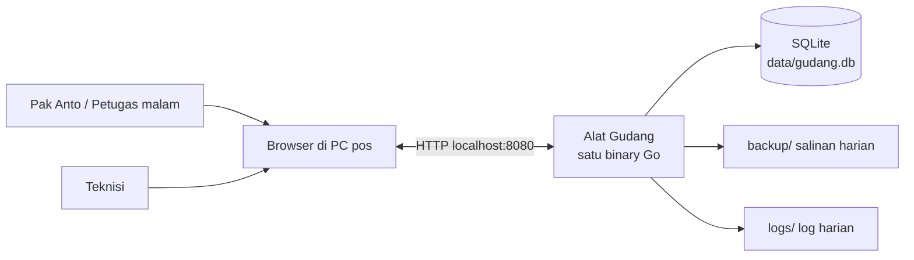
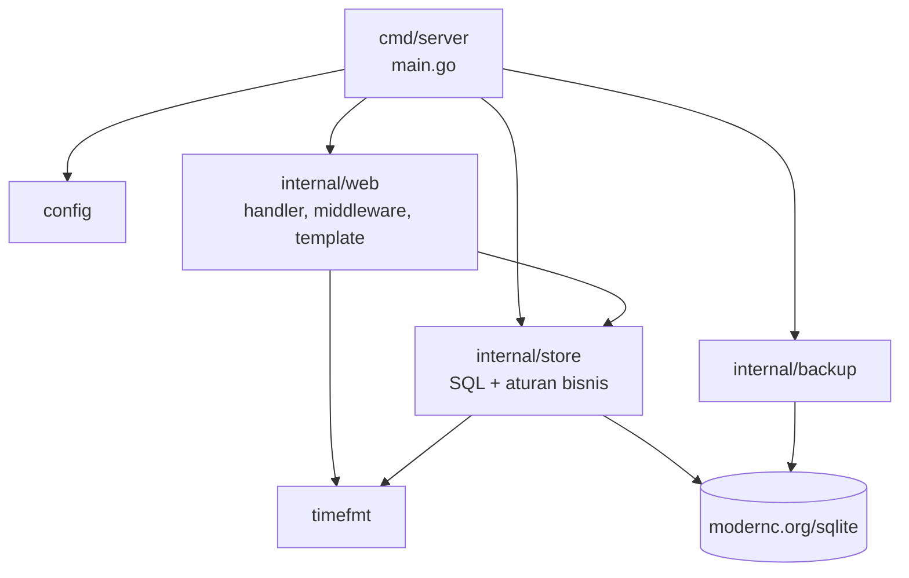
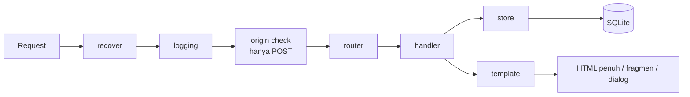
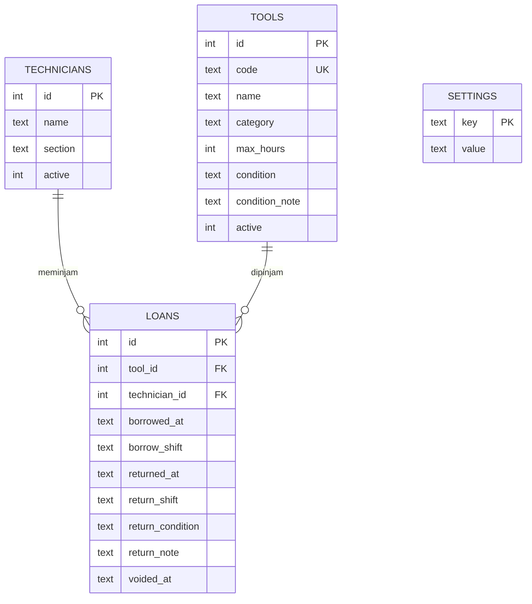
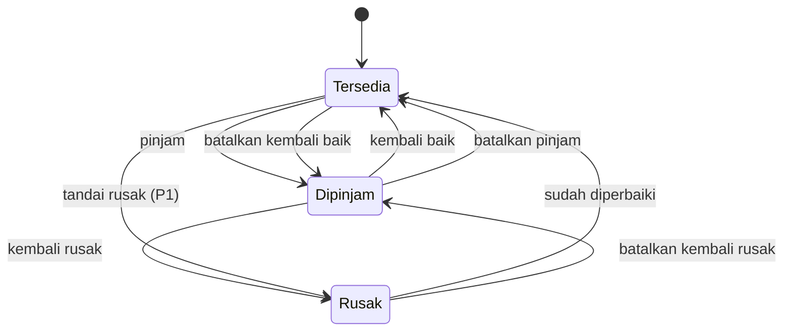
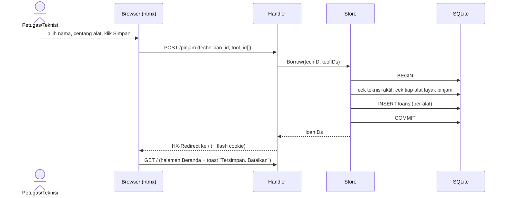
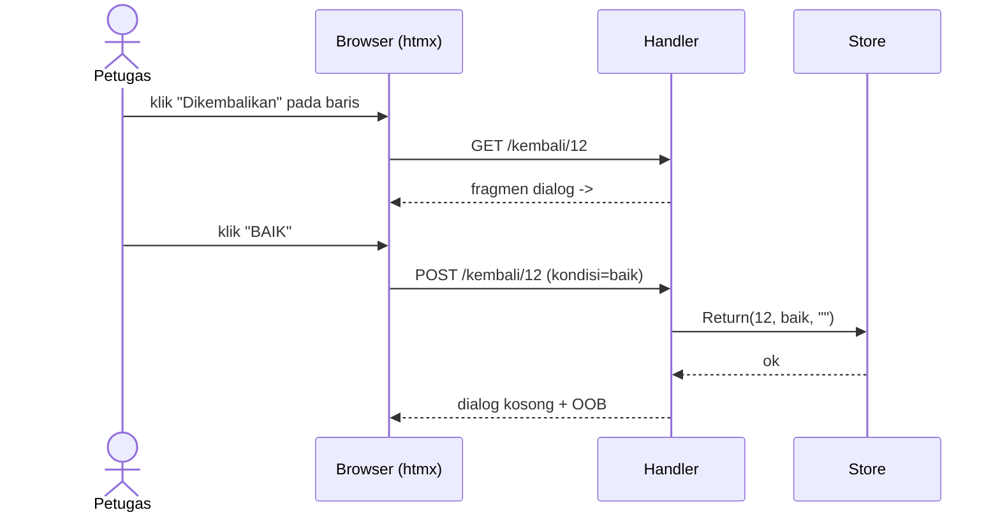
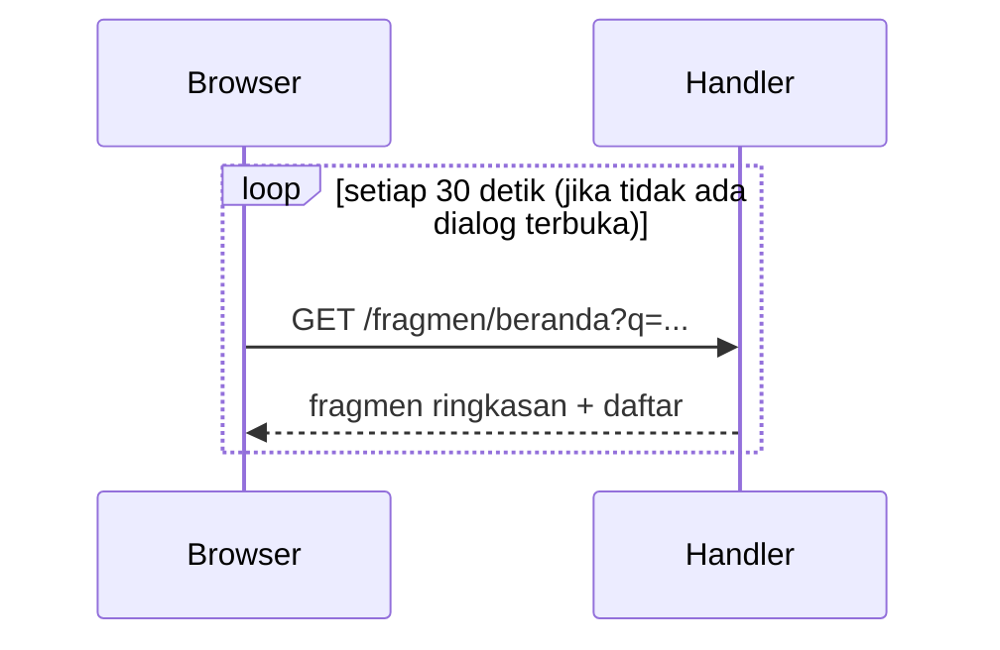
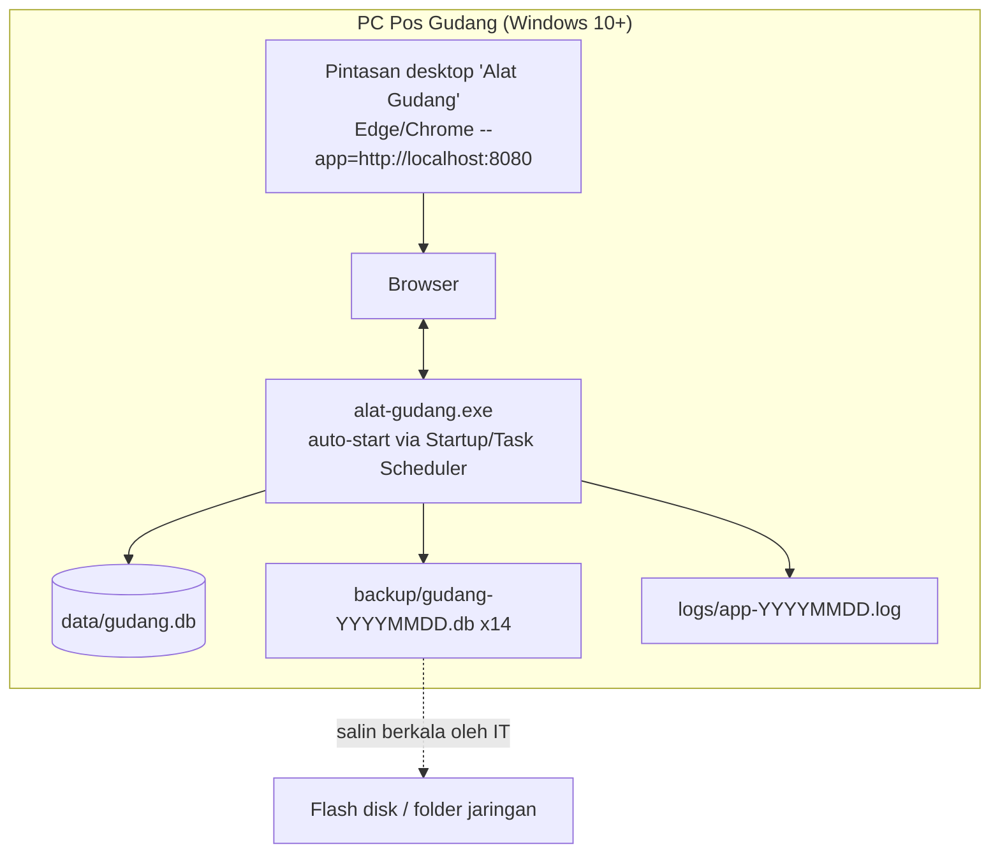

# System Design: Alat Gudang

> **Versi:** 0.1 · 5 November 2026
> **Dokumen induk:** `planning.md` (scope, pertanyaan, asumsi, fitur yang tidak dibuat)
> **Stack:** Go · htmx · Tailwind CSS · SQLite
> **Catatan:** diagram memakai Mermaid (dirender otomatis di GitHub/GitLab/VS Code).

---

## 1. Tujuan dokumen

Dokumen ini menjelaskan **bagaimana** aplikasi dibangun: arsitektur, desain domain dan data, kontrak HTTP/htmx, penanganan konsistensi dan error, deployment, serta alasan di balik keputusan teknis. Scope fitur mengacu ke `planning.md` bagian 5 (P0/P1).

---

## 2. Kebutuhan

### 2.1 Kebutuhan fungsional

| ID | Kebutuhan | Prioritas |
|----|-----------|-----------|
| FR-1 | Menampilkan siapa memegang alat apa dan sejak kapan (Beranda) | P0 |
| FR-2 | Mencatat peminjaman satu atau beberapa alat oleh satu teknisi | P0 |
| FR-3 | Mencatat pengembalian dengan kondisi Baik/Rusak (+ catatan cepat) | P0 |
| FR-4 | Menandai alat "Perlu dicek" bila melewati batas waktu (default 24 jam, bisa per alat) | P0 |
| FR-5 | Menampilkan peminjam terakhir dan riwayat tiap alat | P0 |
| FR-6 | Mengelola status Rusak → Sudah diperbaiki; alat rusak tidak bisa dipinjam | P0 |
| FR-7 | Membatalkan salah catat (pinjam atau kembali) tanpa menghapus data | P0 |
| FR-8 | Mengelola master data alat, teknisi, dan pengaturan | P0 |
| FR-9 | Mencari di Beranda berdasarkan kode alat/nama alat/nama teknisi | P0 |
| FR-10 | Tampilan per teknisi, riwayat global, impor CSV, tandai rusak manual | P1 |

### 2.2 Kebutuhan non-fungsional

| Aspek | Target |
|-------|--------|
| **Usability** | Pinjam 1 alat ≤ 4 klik tanpa mengetik; kembali ≤ 2 klik; hanya mouse; teks ≥ 18px; tombol ≥ 56px |
| **Performa** | Respons server p95 < 100 ms; Beranda tampil < 1 detik di PC lama |
| **Skala** | ≤ 100 alat, ≤ 20 teknisi, ≈ 30 peminjaman/hari, ≤ 3 pengguna bersamaan |
| **Pertumbuhan data** | ≈ 11 ribu baris loan/tahun; DB < 5 MB setelah 5 tahun |
| **Ketersediaan** | Single node, otomatis jalan saat PC menyala; pemulihan < 15 menit |
| **Durabilitas** | RPO ≤ 24 jam (backup harian); data tidak rusak saat listrik padam |
| **Kompatibilitas** | Berjalan tanpa internet; browser desktop 2020+ (Chrome/Edge/Firefox) |
| **Keamanan** | Akses lokal; tidak ada data sensitif; transaksi tidak bisa dihapus permanen |
| **Maintainability** | Satu binary, dependensi pihak ketiga minimal (hanya driver SQLite) |

### 2.3 Batasan

- PC pos berupa komputer lama dengan Windows. **Go ≥ 1.21 membutuhkan Windows 10 atau lebih baru.** Jika ternyata Windows 7/8: upgrade OS, atau jalankan server di PC lain di LAN sehingga PC pos hanya membuka browser.
- Tidak ada internet, jadi semua aset (htmx, CSS) di-embed.
- Pengguna utama tidak terbiasa komputer, jadi tidak boleh ada konsep teknis (login, password, error code) di UI.

---

## 3. Arsitektur

### 3.1 Konteks sistem



Tidak ada sistem eksternal (tanpa email, WhatsApp, ERP, atau cloud). Seluruh sistem berada di satu mesin.

### 3.2 Gaya arsitektur

**Monolit server-rendered.** Browser hanya menampilkan HTML dari server. htmx menukar potongan HTML (fragmen) tanpa muat ulang halaman penuh. Tidak ada API JSON, tidak ada state sisi klien, dan tidak ada build JavaScript.

### 3.3 Komponen dan dependensi paket



Aturan layer (dijaga lewat code review):

1. `store` **tidak boleh** mengimpor `web` (tidak ada siklus).
2. Semua aturan bisnis ada di `store`; handler hanya *parse → panggil store → render*.
3. SQL hanya ada di `store`. Template hanya menerima *view model*, tidak pernah menerima baris DB mentah.
4. `web` mendefinisikan interface kecil yang dibutuhkannya dari `store` agar handler mudah diuji dengan fake.
5. Waktu diambil dari `Clock` yang di-inject (`timefmt.Clock`), tidak memanggil `time.Now()` langsung di `store`.

### 3.4 Alur request umum



---

## 4. Desain domain

### 4.1 Model entitas



DDL lengkap ada di `planning.md` bagian 9 dan **tidak berubah** di dokumen ini. Tambahan di level koneksi:

```
file:data/gudang.db?_pragma=busy_timeout(5000)&_pragma=journal_mode(WAL)&_pragma=foreign_keys(1)&_pragma=synchronous(NORMAL)
```

Di `main.go` pool koneksi dibatasi `db.SetMaxOpenConns(1)`. Dengan beban sekecil ini, semua operasi menjadi serial, sehingga tidak ada `SQLITE_BUSY` dan perilaku mudah diprediksi.

### 4.2 Status alat (diturunkan, tidak disimpan)



Rumus status:

```
status(tool) = Rusak     jika tools.condition = 'rusak'
             = Dipinjam  jika ada loan dengan returned_at IS NULL AND voided_at IS NULL
             = Tersedia  selain itu
```

### 4.3 Invarian (selalu benar)

| # | Invarian | Ditegakkan oleh |
|---|----------|-----------------|
| I1 | Satu alat paling banyak punya satu loan terbuka | Partial unique index `ux_loans_one_open_per_tool` + validasi di `Borrow` |
| I2 | Alat rusak/nonaktif tidak bisa dipinjam | Validasi `requireLoanable` dalam transaksi |
| I3 | Peminjaman beberapa alat bersifat atomik | Satu transaksi DB |
| I4 | Riwayat tidak pernah dihapus | Tidak ada `DELETE` di kode; hanya `voided_at` dan `active=0` |
| I5 | Pengembalian hanya sekali per loan | `UPDATE … WHERE returned_at IS NULL` (compare-and-set) |
| I6 | Pembatalan hanya untuk transaksi terakhir sebuah alat | Cek di `Void*` |
| I7 | `return_condition='rusak'` ⇒ `tools.condition='rusak'` | Satu transaksi di `Return` |

### 4.4 Query kunci

**Beranda: daftar sedang dipinjam** (di-sort terlama dulu; "Perlu dicek" dihitung di Go dengan jam yang di-inject agar bisa diuji):

```sql
SELECT l.id, t.id, t.code, t.name, t.max_hours,
       p.name, p.section, l.borrowed_at, l.borrow_shift
FROM loans l
JOIN tools t        ON t.id = l.tool_id
JOIN technicians p  ON p.id = l.technician_id
WHERE l.returned_at IS NULL AND l.voided_at IS NULL
ORDER BY l.borrowed_at ASC, l.id ASC;
```

**Beranda: alat rusak + peminjam terakhir:**

```sql
SELECT t.id, t.code, t.name, t.condition_note,
       p.name AS last_borrower, l.returned_at
FROM tools t
LEFT JOIN loans l ON l.id = (
    SELECT id FROM loans
    WHERE tool_id = t.id AND voided_at IS NULL
    ORDER BY borrowed_at DESC, id DESC LIMIT 1)
LEFT JOIN technicians p ON p.id = l.technician_id
WHERE t.condition = 'rusak' AND t.active = 1;
```

**Semua Alat + status + pemegang:** `tools` LEFT JOIN loan terbuka LEFT JOIN `technicians`.
**Riwayat alat:** `loans` untuk `tool_id` non-void, `ORDER BY borrowed_at DESC LIMIT 50` (+ "Tampilkan lebih banyak").

Pencarian (`q`) **difilter di Go** pada hasil query di atas (maksimal ratusan baris), bukan di SQL. Ini lebih sederhana, tidak ada risiko injeksi, dan cepat.

---

## 5. Desain layer `store`

### 5.1 Tipe dan error

```go
type Condition string
const (
    Baik  Condition = "baik"
    Rusak Condition = "rusak"
)

var (
    ErrNotFound   = errors.New("data tidak ditemukan")
    ErrInvalid    = errors.New("input tidak valid")
    ErrCannotUndo = errors.New("sudah ada pencatatan lain setelahnya")
    ErrAlreadyReturned = errors.New("sudah tercatat dikembalikan")
)

// UnavailableError membawa konteks agar pesan ke pengguna bisa ramah.
type UnavailableError struct {
    ToolID     int64
    Code       string
    Reason     string // "dipinjam" | "rusak" | "nonaktif"
    HolderName string // terisi bila Reason == "dipinjam"
}
```

### 5.2 Operasi utama

```go
type Store struct {
    db    *sql.DB
    clock timefmt.Clock
    loc   *time.Location
}

// Perintah (menulis)
func (s *Store) Borrow(ctx context.Context, techID int64, toolIDs []int64) (loanIDs []int64, err error)
func (s *Store) Return(ctx context.Context, loanID int64, c Condition, note string) error
func (s *Store) VoidBorrow(ctx context.Context, loanIDs []int64) error   // batalkan pinjam
func (s *Store) VoidReturn(ctx context.Context, loanID int64) error      // batalkan kembali
func (s *Store) MarkRepaired(ctx context.Context, toolID int64) error
func (s *Store) MarkDamaged(ctx context.Context, toolID int64, note string) error // P1

// Kueri (membaca)
func (s *Store) Dashboard(ctx context.Context, q string) (DashboardVM, error)
func (s *Store) ListTools(ctx context.Context, filter ToolFilter) ([]ToolRow, error)
func (s *Store) ToolDetail(ctx context.Context, id int64, offset int) (ToolDetailVM, error)
func (s *Store) LoanableTools(ctx context.Context) ([]ToolRow, error)
func (s *Store) ActiveTechnicians(ctx context.Context) ([]Technician, error)
// + CRUD Kelola: UpsertTool, UpsertTechnician, SetToolActive, SetTechnicianActive, Settings
```

### 5.3 `Borrow` (satu transaksi, semua-atau-tidak-sama-sekali)

```go
func (s *Store) Borrow(ctx context.Context, techID int64, toolIDs []int64) ([]int64, error) {
    if len(toolIDs) == 0 {
        return nil, ErrInvalid
    }
    now := s.clock.Now().UTC()
    shift := s.shiftAt(now)

    tx, err := s.db.BeginTx(ctx, nil)
    if err != nil { return nil, err }
    defer tx.Rollback() // aman dipanggil setelah Commit

    if err := requireActiveTechnician(ctx, tx, techID); err != nil { return nil, err }

    ids := make([]int64, 0, len(toolIDs))
    for _, toolID := range toolIDs {
        if err := requireLoanable(ctx, tx, toolID); err != nil { return nil, err } // *UnavailableError
        res, err := tx.ExecContext(ctx,
            `INSERT INTO loans (tool_id, technician_id, borrowed_at, borrow_shift)
             VALUES (?, ?, ?, ?)`, toolID, techID, fmtUTC(now), shift)
        if err != nil { return nil, mapUniqueViolation(ctx, tx, err, toolID) } // jaring pengaman terakhir
        id, _ := res.LastInsertId()
        ids = append(ids, id)
    }
    return ids, tx.Commit()
}
```

### 5.4 `Return`

```go
func (s *Store) Return(ctx context.Context, loanID int64, c Condition, note string) error {
    if c != Baik && c != Rusak { return ErrInvalid }
    now := s.clock.Now().UTC()

    tx, err := s.db.BeginTx(ctx, nil)
    if err != nil { return err }
    defer tx.Rollback()

    // compare-and-set: hanya berhasil jika loan masih terbuka (aman dari klik ganda)
    res, err := tx.ExecContext(ctx, `
        UPDATE loans SET returned_at=?, return_shift=?, return_condition=?, return_note=?
        WHERE id=? AND returned_at IS NULL AND voided_at IS NULL`,
        fmtUTC(now), s.shiftAt(now), string(c), note, loanID)
    if err != nil { return err }
    if n, _ := res.RowsAffected(); n == 0 { return ErrAlreadyReturned }

    if c == Rusak {
        if _, err := tx.ExecContext(ctx, `
            UPDATE tools SET condition='rusak', condition_note=?
            WHERE id = (SELECT tool_id FROM loans WHERE id=?)`, note, loanID); err != nil {
            return err
        }
    }
    return tx.Commit()
}
```

### 5.5 Pembatalan

| Operasi | Syarat | Efek |
|---------|--------|------|
| `VoidBorrow(loanIDs)` | Semua loan masih terbuka (belum dikembalikan) | `voided_at = now` |
| `VoidReturn(loanID)` | Loan sudah dikembalikan, merupakan loan non-void terbaru alat itu, dan alat tidak sedang punya loan terbuka lain | `returned_at/return_*` dikosongkan; jika sebelumnya rusak karena loan ini, `tools.condition='baik'` dan catatan dikosongkan |

Jika syarat tidak terpenuhi → `ErrCannotUndo` → pesan: *"Tidak bisa dibatalkan karena sudah ada pencatatan lain setelahnya."*

---

## 6. Desain HTTP dan htmx

### 6.1 Routing (Go ≥ 1.22, `http.ServeMux` dengan pola method + path)

```go
mux.HandleFunc("GET /{$}",                    h.beranda)
mux.HandleFunc("GET /fragmen/beranda",        h.fragmenBeranda)
mux.HandleFunc("GET /pinjam",                 h.formPinjam)
mux.HandleFunc("POST /pinjam",                h.postPinjam)
mux.HandleFunc("GET /kembali/{loanID}",       h.dialogKembali)
mux.HandleFunc("POST /kembali/{loanID}",      h.postKembali)
mux.HandleFunc("POST /batal",                 h.postBatal)
mux.HandleFunc("GET /alat",                   h.daftarAlat)
mux.HandleFunc("GET /alat/{id}",              h.detailAlat)
mux.HandleFunc("POST /alat/{id}/diperbaiki",  h.postDiperbaiki)
mux.HandleFunc("GET /kelola/{bagian}",        h.kelola)            // alat | teknisi | pengaturan
mux.HandleFunc("POST /kelola/alat",           h.simpanAlat)        // tambah/ubah (id opsional)
mux.HandleFunc("POST /kelola/teknisi",        h.simpanTeknisi)
mux.HandleFunc("POST /kelola/{jenis}/{id}/aktif", h.ubahAktif)     // nonaktifkan / aktifkan
mux.HandleFunc("POST /kelola/pengaturan",     h.simpanPengaturan)
mux.HandleFunc("GET /healthz",                h.healthz)
mux.Handle("GET /static/", staticHandler)     // embed.FS + cache-busting
```

### 6.2 Kontrak endpoint utama

| Endpoint | Input | Sukses | Gagal |
|----------|-------|--------|-------|
| `POST /pinjam` | `technician_id`, `tool_id` (berulang) | Redirect (`HX-Redirect: /`) + pesan sukses disimpan lewat cookie flash sekali-pakai → toast di Beranda, berisi tombol **Batalkan** untuk semua `loan_id` baru | 422 + toast merah (mis. "MM-01 sedang dipinjam Budi") dan form tetap utuh |
| `GET /kembali/{id}` | - | Fragmen dialog (hanya dengan header `HX-Request`) | 404 → toast |
| `POST /kembali/{id}` | `kondisi` ∈ {baik, rusak}, `catatan` (opsional, dari chip + teks bebas) | 200: dialog dikosongkan + OOB `#beranda-live` + OOB `#toast` | 409 jika sudah dikembalikan → toast "Alat ini sudah tercatat dikembalikan" + daftar disegarkan |
| `POST /batal` | `loan_id` (berulang), `jenis` ∈ {pinjam, kembali} | 200: OOB daftar + toast | 409 `ErrCannotUndo` |
| `GET /fragmen/beranda?q=` | `q` opsional | Fragmen `beranda_live` | - |
| `POST /alat/{id}/diperbaiki` | - | OOB daftar + toast | 404 |

Fragmen/dialog yang diakses langsung tanpa header `HX-Request` (mis. diketik di browser) → redirect ke `/`.

### 6.3 Pola render dan template

```
templates/
├── layout.html            # <html>, nav, #toast, #dialog, #beranda-live slot, meta htmx-config
├── pages/                 # beranda, pinjam, alat_list, alat_detail, kelola_*, error
└── partials/              # beranda_live, loan_row, dialog_kembali, toast, tool_card, riwayat_row
```

- Template di-*parse* **sekali saat start** ke `map[string]*template.Template` (satu set per halaman: `layout` + `partials/*` + file halaman) agar nama `block` tidak bertabrakan. Flag `-dev` memuat ulang dari disk saat pengembangan.
- `html/template` dengan `FuncMap` kecil: `rel` (waktu relatif), `clock` (jam pasti WIB), `plural`, `statusLabel`.
- **Dialog** dibuat dari `div` overlay biasa (CSS), bukan elemen `<dialog>`, agar aman di browser lama.
- Chip catatan kerusakan berasal dari **allowlist di server** (Tidak menyala, Patah/aus, Aksesori hilang, Lainnya) + teks bebas opsional yang di-escape otomatis.

### 6.4 Urutan interaksi

**a. Pinjam alat**



**b. Kembalikan alat (dua klik)**



Jalur rusak sama, tetapi setelah "ADA KERUSAKAN" dialog menampilkan chip + catatan dan tombol Simpan; `Return(12, rusak, note)` juga menandai alat Rusak.

**c. Penyegaran otomatis**



Atribut kunci pada Beranda:

```html
<div id="beranda-live"
     hx-get="/fragmen/beranda" hx-include="#q"
     hx-trigger="every 30s [document.getElementById('dialog').childElementCount === 0]"
     hx-swap="innerHTML">
  {{template "beranda_live" .}}
</div>
<input id="q" name="q" hx-get="/fragmen/beranda" hx-target="#beranda-live"
       hx-trigger="input changed delay:300ms">
```

### 6.5 Kontrak respons (OOB dan error)

Respons sukses aksi (kembali/batal/diperbaiki) berisi, selain konten utama yang kosong:

```html
<div id="beranda-live" hx-swap-oob="innerHTML">…ringkasan + daftar terbaru…</div>
<div id="toast"        hx-swap-oob="innerHTML">…pesan + tombol Batalkan…</div>
```

Satu round-trip memperbarui dialog, daftar, angka, dan pesan sekaligus.

**Pemetaan error → HTTP → pesan pengguna**

| Error `store` | HTTP | Pesan (Bahasa Indonesia, netral) |
|---------------|------|-----------------------------------|
| `UnavailableError{Reason:"dipinjam"}` | 422 | "MM-01 sedang dipinjam Budi sejak Sel 09:10." |
| `UnavailableError{Reason:"rusak"}` | 422 | "MM-01 sedang ditandai rusak." |
| `ErrAlreadyReturned` | 409 | "Alat ini sudah tercatat dikembalikan." |
| `ErrCannotUndo` | 409 | "Tidak bisa dibatalkan karena sudah ada pencatatan lain setelahnya." |
| `ErrInvalid` | 422 | "Pilih teknisi dan minimal satu alat dulu." |
| `ErrNotFound` | 404 | "Data tidak ditemukan. Coba muat ulang." |
| lainnya / panic | 500 | "Ada gangguan. Coba lagi, atau hubungi IT." (detail hanya di log) |

Karena htmx secara default tidak menukar respons 4xx/5xx, `layout.html` mengatur `htmx-config` (`responseHandling`) agar 4xx/5xx tetap ditukar, dan server menambahkan `HX-Reswap: none` supaya hanya OOB toast yang diproses. Perilaku ini **diverifikasi di M0** sebelum fitur lain dibangun.

### 6.6 Middleware

| Urutan | Middleware | Fungsi |
|--------|-----------|--------|
| 1 | `recover` | Menangkap panic → halaman/toast error ramah + log stack |
| 2 | `logging` | `slog`: method, path, status, durasi, `hx=true/false` |
| 3 | `crossOrigin` | Menolak POST lintas-origin (cek `Sec-Fetch-Site`/`Origin`; `http.CrossOriginProtection` di Go 1.25+) |
| 4 | `noCache` | `Cache-Control: no-store` untuk halaman dinamis (agar Beranda tidak basi saat tombol Back) |

Aset statis memakai `Cache-Control: public, max-age=31536000, immutable` dengan URL ber-hash (`/static/app.css?v=<hash>`) yang dihitung saat start dari `embed.FS`.

---

## 7. Sistem UI

### 7.1 Token desain (Tailwind)

| Token | Nilai | Pemakaian |
|-------|-------|-----------|
| Font | System font stack (Segoe UI, Arial); **tanpa web font** (offline) | Semua teks |
| Ukuran dasar | `text-lg` (18px); judul `text-2xl`+; angka ringkasan `text-5xl` | Keterbacaan |
| Tombol | `min-h-14` (56px), `px-6`, `text-lg font-semibold`, jarak antar tombol ≥ `gap-4` | Aksi utama |
| Warna status | **ok** hijau · **warn** amber · **bad** merah, selalu dengan ikon + teks (tidak hanya warna) | Badge/baris |
| Fokus | `ring-4` tebal | Aksesibilitas mouse + keyboard |
| Kontras | Rasio ≥ 4.5:1 (teks), ≥ 3:1 (komponen) | Layar pabrik yang kusam |

### 7.2 Komponen

`NavBar` · `SummaryCard` (angka besar) · `LoanRow` · `Badge` (Tersedia/Dipinjam/Perlu dicek/Rusak) · `PickCard` (kartu pilih teknisi/alat, mendukung state terpilih/abu-abu) · `Dialog` (overlay) · `Toast` (dengan tombol Batalkan, tetap tampil sampai ditutup atau aksi berikutnya) · `PrimaryButton` / `SecondaryButton`.

Tombol aksi memakai `hx-disabled-elt="this"` agar tidak bisa terklik dua kali.

### 7.3 Pipeline CSS

- `make css` menjalankan Tailwind standalone CLI (tanpa Node) dengan `content: ["internal/web/templates/**/*.html"]` → `internal/web/static/app.css`.
- Hasil `app.css` **di-commit**, sehingga build produksi tidak memerlukan Tailwind CLI.
- Default Tailwind v3.4 untuk keamanan di browser lama; v4 hanya bila browser pos terbukti modern.

---

## 8. Konsistensi dan konkurensi

| Skenario | Penanganan |
|----------|------------|
| Dua orang meminjam alat yang sama bersamaan | Validasi dalam transaksi; bila terlewat, **partial unique index** menolak `INSERT` → `UnavailableError` dengan nama pemegang |
| Klik ganda "Dikembalikan" | `UPDATE … WHERE returned_at IS NULL`; klik kedua 0 baris → `ErrAlreadyReturned` (pesan ramah, bukan error) |
| Pinjam banyak alat, salah satu gagal | Rollback seluruh transaksi; tidak ada peminjaman setengah jadi |
| Beranda basi di layar lain | Polling 30 detik + `no-store` |
| Listrik padam di tengah tulis | WAL + `synchronous=NORMAL`; transaksi yang belum commit dibatalkan otomatis saat pemulihan |
| Pembatalan tabrakan dengan aksi lain | Syarat "transaksi terakhir" dicek di dalam transaksi yang sama |

Karena pool dibatasi satu koneksi, seluruh transaksi berjalan serial. Cukup untuk ≤ 3 pengguna, dan indeks unik tetap menjadi jaring pengaman jika di masa depan pool diperbesar.

---

## 9. Waktu dan lokalisasi

- Database menyimpan **UTC** (`RFC3339`). Tampilan memakai zona dari `TZ` (default `Asia/Jakarta`).
- `import _ "time/tzdata"` agar zona waktu tersedia di Windows tanpa database zona.
- `timefmt` menyediakan: `Clock` (interface, ada `RealClock` dan `FakeClock` untuk tes), `RelativeID` ("3 jam lalu", "kemarin", "2 hari lalu"), `ShiftAt(t, cfg)` (pagi 07:00-19:00 / malam 19:00-07:00; menangani lintas tengah malam), dan format hari/bulan berbahasa Indonesia ("Sel 09:10", "5 Nov").
- Seluruh teks UI dalam Bahasa Indonesia, disimpan di template/konstanta (belum perlu sistem i18n).

---

## 10. Keamanan

| Ancaman | Mitigasi |
|---------|----------|
| Akses dari jaringan tak dikenal | Bind default `127.0.0.1`; membuka ke LAN hanya lewat konfigurasi eksplisit |
| CSRF dari halaman lain di browser yang sama | Middleware cek `Origin`/`Sec-Fetch-Site` untuk semua POST |
| XSS (nama/catatan berisi HTML) | `html/template` meng-escape otomatis; chip dari allowlist |
| SQL injection | Semua query berparameter; tidak ada penyusunan SQL dari input |
| Manipulasi riwayat | Tidak ada fitur hapus; pembatalan tercatat dengan `voided_at`; perubahan master data dicatat di log |
| Akses fisik ke PC pos | Diterima sebagai risiko MVP (asumsi A11); jalur upgrade: PIN untuk menu Kelola |
| File DB rusak | Backup harian, `PRAGMA quick_check` saat start (lihat bagian 13) |

Tidak ada kredensial, token, atau data pribadi sensitif; hanya nama dan bagian teknisi.

---

## 11. Observabilitas

- **Log:** `log/slog` (teks, satu baris per kejadian) ke `logs/app-YYYYMMDD.log` + stdout; file lebih dari 30 hari dihapus saat start.
- **Isi log request:** waktu, method, path, status, durasi ms, `hx`.
- **Isi log bisnis:** `borrow`, `return`, `void`, `repair`, `upsert_tool`, `upsert_technician` beserta ID terkait (jejak audit sederhana).
- **Health:** `GET /healthz` → `200 ok` + versi + hasil `db.PingContext`.
- **Versi:** `alat-gudang.exe -version`.
- Tidak ada metrik/tracing eksternal (tidak sepadan untuk skala ini).

---

## 12. Konfigurasi dan siklus hidup

### 12.1 Konfigurasi

| Env/flag | Default | Keterangan |
|----------|---------|------------|
| `ADDR` | `127.0.0.1:8080` | Alamat dengar |
| `DB_PATH` | `data/gudang.db` | Lokasi database |
| `BACKUP_DIR` | `backup` | Folder backup |
| `LOG_DIR` | `logs` | Folder log |
| `TZ` | `Asia/Jakarta` | Zona tampilan |
| `-dev` | `false` | Muat template dari disk |
| `-seed` | `false` | Isi data contoh |
| `-import-tools`, `-import-technicians` | - | Impor CSV (P1) |

Pengaturan yang diubah pengguna (batas default, jam shift) ada di tabel `settings`, bukan env.

### 12.2 Urutan start

1. Baca konfigurasi dan muat zona waktu.
2. Buka DB (PRAGMA), jalankan `PRAGMA quick_check`; bila gagal → tampil halaman pemulihan, **tidak menimpa data**.
3. Jalankan migrasi dari `embed` (`PRAGMA user_version`, tiap migrasi dalam transaksi).
4. Isi nilai default `settings` jika kosong.
5. Backup awal (`VACUUM INTO`) + jadwalkan backup tiap 24 jam + bersihkan > 14 salinan.
6. Parse template, hitung hash aset, daftarkan route.
7. `http.Server` dengan `ReadHeaderTimeout`, `ReadTimeout`, `WriteTimeout`, `IdleTimeout`.

### 12.3 Shutdown

Menangkap `SIGINT/SIGTERM` (dan penutupan konsol di Windows) → `server.Shutdown` dengan batas 5 detik → backup terakhir → tutup DB.

---

## 13. Deployment, backup, pemulihan



**Build dan rilis**

```
make css          # Tailwind -> app.css (commit hasilnya)
make test
make build-win    # GOOS=windows GOARCH=amd64 go build -trimpath -ldflags "-s -w -X main.version=..." -o dist/alat-gudang.exe ./cmd/server
```

Paket rilis: `alat-gudang.exe` + `README.txt` (cara pasang 1 halaman) + folder kosong `data/`. Pembaruan = ganti `.exe` (migrasi berjalan otomatis).

**Pemulihan (target < 15 menit)**

1. Tutup aplikasi.
2. Salin backup terbaru ke `data/gudang.db`.
3. Jalankan aplikasi. Data hilang paling lama sejak backup terakhir (RPO ≤ 24 jam).
4. Selisih diisi ulang dari buku besar (yang masih berdampingan selama masa transisi).

---

## 14. Strategi pengujian

| Level | Cakupan | Alat |
|-------|---------|------|
| Unit `timefmt` | Shift lintas tengah malam, waktu relatif, batas "Perlu dicek" | `testing`, `FakeClock` |
| Unit/integrasi `store` | I1-I7: pinjam ganda ditolak, atomik multi-alat, kembali baik/rusak, klik ganda, batalkan, pembatalan terblokir, alat nonaktif/rusak, status turunan | SQLite in-memory/temp file, migrasi asli |
| Handler | Kontrak bagian 6.2: header `HX-*`, OOB, kode status, penolakan POST lintas-origin, redirect fragmen tanpa HTMX | `httptest` + fake store |
| Render | Semua halaman dan fragmen ter-render dengan data contoh tanpa error template | Smoke test |
| Manual | Skrip uji pakai dengan orang awam (planning bagian 14) | Checklist |

Target: seluruh aturan bisnis di `store` memiliki tes; `go vet` dan `go test ./...` hijau sebelum build rilis.

---

## 15. Keputusan desain (ADR ringkas)

| # | Keputusan | Alternatif | Alasan | Konsekuensi |
|---|-----------|-----------|--------|-------------|
| 1 | **Monolit server-rendered + htmx** | SPA (React/Vue) | Tanpa build JS, UI sederhana, cocok dengan tim kecil dan PC lama | Interaksi sangat kaya perlu teknik tambahan |
| 2 | **SQLite (WAL), satu file** | PostgreSQL/MySQL | Nol administrasi, mudah di-backup, cukup untuk skala | Satu penulis; migrasi ke server DB bila multi-lokasi (antarmuka `store` memudahkan) |
| 3 | Driver **pure Go** `modernc.org/sqlite` | `mattn/go-sqlite3` (CGO) | Cross-compile Windows tanpa compiler C | Sedikit lebih lambat, tidak relevan di skala ini |
| 4 | **Status alat diturunkan** dari data loan | Kolom `status` | Menghindari data tidak sinkron | Query sedikit lebih kompleks |
| 5 | **Void, bukan hapus** | `DELETE` | Riwayat/jejak tetap utuh, selaras dengan tujuan "siapa terakhir meminjam" | Data tumbuh (sangat kecil) |
| 6 | **Tanpa login** | Akun + peran | Hambatan bagi pengguna; komputer bersama | Bergantung keamanan fisik; PIN Kelola di fase 2 |
| 7 | **Polling 30 detik** | SSE/WebSocket | Cukup untuk kebutuhan, jauh lebih sederhana | Maksimal 30 detik keterlambatan di layar lain |
| 8 | **Filter pencarian di Go** | `LIKE` di SQL | Data kecil; mudah diuji; tanpa risiko injeksi | Tidak cocok bila data jadi puluhan ribu |
| 9 | **`net/http` stdlib** (Go ≥ 1.22) | chi/gin | Cukup untuk routing; nol dependensi | Perlu Go ≥ 1.21 (Windows 10+) |
| 10 | **Tailwind standalone CLI**, CSS di-commit | Node + npm | Tanpa Node di mesin build maupun produksi | Satu langkah `make css` saat mengubah template |
| 11 | **Aset di-embed** (`go:embed`) | CDN | Offline, satu file | Biner sedikit lebih besar |
| 12 | **Waktu di-inject** (`Clock`) | `time.Now()` langsung | Tes "Perlu dicek" dan shift deterministik | Sedikit boilerplate |
| 13 | **Batas waktu default global + override per alat** | Per kategori | Paling sederhana yang masih fleksibel | Kategori bisa ditambah nanti |
| 14 | **Aksi menyegarkan UI via OOB, satu round-trip** | Memicu event lalu fetch ulang | Lebih sedikit request, UI konsisten | Template fragmen harus dipakai bersama |

---

## 16. Keterbatasan dan jalur pengembangan

**Keterbatasan MVP yang diketahui**

- Single node: bila PC pos mati, aplikasi tidak tersedia sampai dipulihkan (buku besar tetap menjadi cadangan selama masa transisi).
- Tidak ada otentikasi; siapa pun di PC pos bisa mengubah data (tetap tercatat, tidak bisa dihapus permanen).
- Tidak ada notifikasi aktif; Pak Anto harus melihat layar.
- Pencarian dan daftar tanpa paginasi (aman di skala saat ini).

**Jalur pengembangan (tanpa menulis ulang)**

| Kebutuhan masa depan | Titik ekstensi |
|----------------------|----------------|
| QR/barcode | Tambah rute `GET /s/{kode}` yang mengarah ke alat atau form pinjam; `tools.code` sudah unik |
| PIN untuk Kelola | Middleware baru pada grup route `/kelola/*` |
| Akses dari banyak PC / TV | Ubah `ADDR`; polling sudah ada; bila beban naik, ganti penyimpanan di balik antarmuka `store` |
| Notifikasi lembut | Paket `notify` terpisah yang membaca query "Perlu dicek"; tidak menyentuh aturan inti |
| Ekspor CSV/laporan | Handler baru memakai query yang sama |
| Modul stok sparepart | Tabel dan paket terpisah (`internal/stock`); tidak mengubah `loans` |
| Banyak gudang | Tambah `locations` dan `location_id` pada `tools`/`loans` |

---

## 17. Perubahan terhadap `planning.md`

Dokumen ini memperjelas beberapa hal yang belum rinci di planning:

1. **Pembatalan** memakai `POST /batal` dengan `loan_id` berulang (bukan `/batal/{loanID}`) agar satu klik "Batalkan" dapat membatalkan peminjaman multi-alat sekaligus.
2. **Fragmen dipisah dari halaman penuh** lewat rute `/fragmen/*` dan dialog (`/kembali/{id}`); cek `HX-Request` hanya dipakai untuk mencegah fragmen dibuka langsung.
3. **Koreksi asumsi A1/Q7:** Go ≥ 1.21 membutuhkan **Windows 10+**; Windows 7/8 tidak didukung.
4. Penambahan detail operasional yang belum ada di planning: pool koneksi satu koneksi, `PRAGMA quick_check` saat start, cache-busting aset, dan graceful shutdown dengan backup terakhir.
